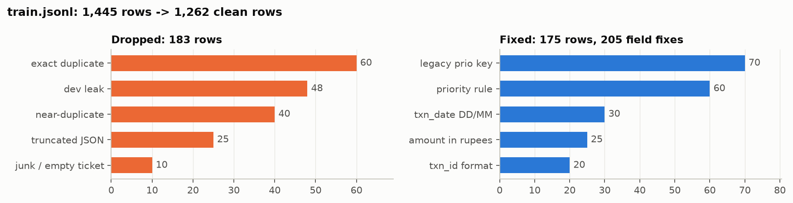

# NimbusPay ticket triage: LoRA fine-tune of Qwen2.5-3B-Instruct

| | |
|---|---|
| **Base model** | [`Qwen/Qwen2.5-3B-Instruct`](https://huggingface.co/Qwen/Qwen2.5-3B-Instruct) (3.09B parameters) |
| **Loaded in 4-bit?** | **No.** The base model is loaded in 16-bit (fp16). 4-bit QLoRA was tested as an experiment (D2) and was not used for the final model. |
| **Best result** | **Dev: 94.0% exact match, 98.8% mean field accuracy, 100% valid JSON** (`score.py`, plain greedy decoding). The zero-shot base model scores 0%. |

## Where to start

| If you want to... | Read |
|---|---|
| Get the full picture in 3 pages | **[`report.md`](report.md)**: data audit, experiment table, error analysis, AI-tool usage |
| See the final model trained and the test predictions produced | [`notebook.ipynb`](notebook.ipynb): runs top to bottom on a fresh T4 in about 100 min, with outputs |
| Check how each data problem was found | [`notebooks/data_prep.ipynb`](notebooks/data_prep.ipynb): the Part A audit, with charts |
| See how the augmentation data was made | [`notebooks/exp4_augmentation.ipynb`](notebooks/exp4_augmentation.ipynb) |

## What was done

**Part A: data audit.** `train.jsonl` went from 1,445 to 1,262 rows: 183 dropped, 175 fixed (205 field fixes), each
logged in [`cleaning_log.csv`](cleaning_log.csv).
- **Dropped:** 25 truncated labels, 10 placeholder or empty tickets, 48 copies of dev tickets (leakage), and 100
  exact or near duplicates.
- **Fixed:** an old `prio` key (70), DD/MM dates (30), un-normalised transaction ids (20), amounts stored in rupees
  instead of paise (25), and priorities that broke the SCHEMA v2 rules (60).
- A final check re-tests every SCHEMA.md rule on every kept row and finds 0 failures.

**Parts B-D: baselines, pipeline, experiments.**
- **Training setup.** A hand-written PyTorch loop in fp16 (the T4 has no bf16). LoRA r=16, α=32 on all 7
  projections, 29.9M trainable parameters. The loss covers only the answer tokens, and nothing is truncated.
- **Experiments.** Each one changes one thing against the reference R1, and runs are compared with a paired
  McNemar test on the same 200 dev rows.

| Run | What changed | Dev exact | Dev field | Peak GPU | Train min |
|---|---|---|---|---|---|
| B1 | Base model, zero-shot | 0.0% | 0.0% | 7.7 GiB | - |
| B2 | Base model + rules in the prompt (reference only) | 23.5% | 80.6% | 8.9 GiB | - |
| R1 | Reference: clean data, fp16 LoRA r16 | 91.5% | 98.2% | 10.4 GiB | 27.5 |
| D1 | Raw data instead of clean | 92.5% | 98.5% | 10.0 GiB | 30.1 |
| D2 | 4-bit QLoRA | 93.5% | 98.7% | 8.3 GiB | 34.3 |
| D3 | LoRA rank 8 | 90.0% | 98.1% | 9.7 GiB | 27.0 |
| D4 | + rule-boundary augmentation | 95.0% | 99.0% | 10.0 GiB | 38.1 |
| **Final** | **D4 configuration, retrained by `notebook.ipynb`** | **94.0%** | **98.8%** | 10.0 GiB | 34.1 |

Two findings stand out:
- **D1 only looks better because of leakage.** It had seen 47 dev tickets in training. On the 153 leak-free dev
  rows, it ties R1.
- **The augmentation is a small gain.** D4 was the only change that beat R1 significantly (p = 0.039), but the
  same configuration trained three times scored 95.0%, 93.5% and 94.0%. The report treats it as a gain of about
  2.5 points, not a proven one.

**Part E: error analysis.** The final model gets 12 dev tickets wrong:
- **Priority (7 tickets) is the weakest field.** The model reads amounts correctly (100%) but sometimes puts them on
  the wrong side of the ₹5k/₹50k rules, or follows a distractor such as an account balance.
- **Refund is the weakest category** (87.3% exact).
- **The test set contains phrasings that train never shows**, such as order numbers and convenience fees. They
  cause predictable errors, which the report documents without tuning on them.

## Repository contents

| Path | Contents |
|---|---|
| `adapter/` | Final LoRA adapter in PEFT format (`adapter_config.json`, `adapter_model.safetensors`, fp16, 57 MB) |
| `predictions_test.jsonl` | 400 lines `{"id", "output"}`: raw model output, generated one ticket at a time with greedy decoding |
| `cleaning_log.csv` | `id,action,reason` for every dropped or fixed training row |
| `report.md` | The report (at most 3 pages) |
| `notebook.ipynb` | The submission notebook, with outputs |
| `notebooks/` | The data audit and augmentation notebooks, with outputs |
| `logs/` | Per-run configs, training logs, dev predictions and scores; `results.csv`; `augmentation_log.csv` |
| `figures/` | Charts from the data audit |

Neither the training data nor the base model is included.

## Reproducing

On a Colab T4, put this repository and the assignment's `candidate_pack/` in one folder, set `USE_DRIVE` in cell 0.3
(`False` means work under `/content/work`), and run all cells.
- **Setup.** The first cell pins the library versions. No Hugging Face token is needed.
- **What it does.** The notebook rebuilds the cleaned data from `train.jsonl` and `cleaning_log.csv`, regenerates
  the augmentation (seeded), trains the final model and writes the adapter and test predictions.
- **What it checks.** It confirms that 20/20 regenerated test predictions match the file. Baselines and earlier
  experiments are shown from `logs/`, and their code is included behind `RERUN_*` flags.

The predictions use the fixed system prompt, the model's own chat template, plain greedy decoding, no constrained
decoding and no post-processing beyond stripping whitespace. No dev or test row was used for training.
